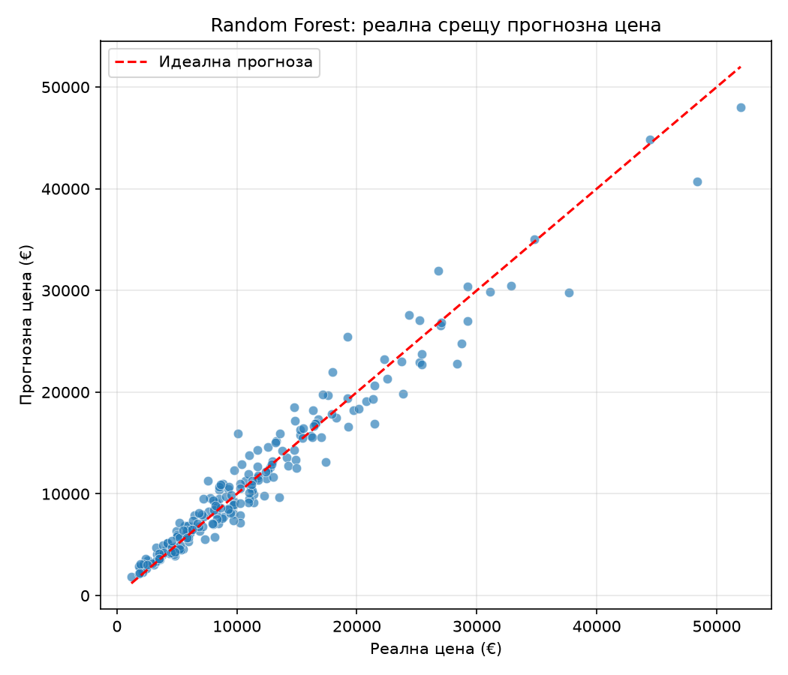
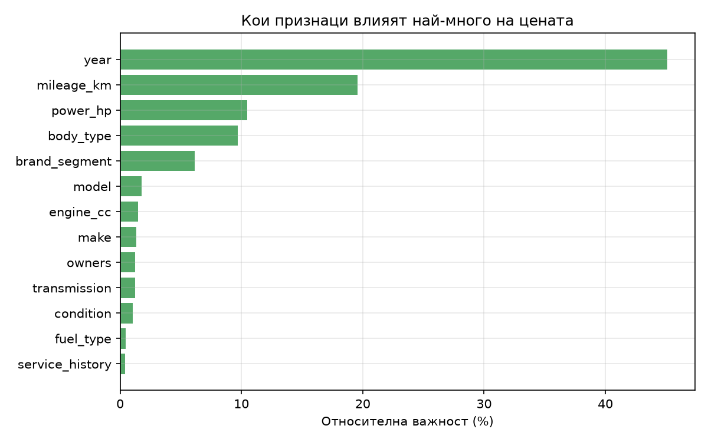

# Прогнозиране на цени на употребявани автомобили

**Ученик:** Георги Младенов Калпакчиев, № 4

**Избран вариант:** Вариант А

**Тема:** Прогнозиране на цени на употребявани автомобили по таблични признаци с Decision Tree / Random Forest

## Какво прави проектът?

Програмата предсказва пазарната цена на употребяван автомобил по 13 таблични признака: марка, модел, пазарен сегмент, година, пробег, обем на двигателя, гориво, скоростна кутия, мощност, тип каросерия, брой собственици, състояние и сервизна история. Пазарният сегмент е ординален признак от 1 (бюджет) до 4 (премиум), зададен по марката; той помага на дърветата да различават класовете по-добре от 20 отделни One-Hot колони.

Използват се два модела за регресия – **Decision Tree** и **Random Forest**. Двата се обучават върху 80% от данните, сравняват се върху останалите 20% и се оценяват с MAE, RMSE, R² и MAPE. Накрая програмата записва модела, метриките и графиките, а с `--predict` може да се направи прогноза за нов автомобил.

## Как се стартира програмата?

1. Инсталирайте нужните библиотеки:

   ```bash
   pip install -r requirements.txt
   ```

2. Стартирайте обучението и оценката:

   ```bash
   python main.py
   ```

   Ако искате по-бързо пускане без GridSearch:

   ```bash
   python main.py --quick
   ```

3. Интерактивна прогноза за нов автомобил:

   ```bash
   python main.py --predict
   ```

4. Прогноза за няколко примерни автомобила:

   ```bash
   python main.py --sample
   ```

> На Windows, ако командата `python` не работи, използвайте `py main.py` или `python3 main.py`.

## Съдържание на хранилището

- `main.py` – изходен код: зареждане на данните, предобработка, обучение, оценка, графики и прогнози.
- `data.csv` – входни данни за обучение и тест (1000 реда, 13 признака + целева цена).
- `generate_data.py` – скрипт, с който е създаден `data.csv` (възпроизводим с фиксиран seed).
- `requirements.txt` – нужните Python библиотеки.
- `Pismena_Teoria.pdf` – писмена теория и анализ за защитата (2–3 страници).
- `metrics.json` – записани метрики, важност на признаците и най-големи грешки.
- `model/used_car_price_model.joblib` – обучен Random Forest модел, който `--predict` зарежда директно.
- `plots/` – графики: реална срещу прогнозна цена, остатъци, важност на признаците, сравнение на моделите и примерно дърво.

## Резултати

Тестови данни: 200 автомобила (20% от всички), обучение: 800 автомобила.

| Модел | MAE | RMSE | R² | MAPE |
|---|---:|---:|---:|---:|
| Baseline (средна цена) | 6 391 € | 8 563 € | -0.003 | 95.3% |
| Decision Tree | 2 126 € | 3 146 € | 0.865 | 20.7% |
| **Random Forest** | **1 291 €** | **1 857 €** | **0.953** | **13.0%** |

5-кратна крос-валидация на Random Forest върху обучаващите данни: **MAE = 1 438 € ± 204 €**, **R² = 0.949 ± 0.012**.

Най-важните признаци според Random Forest: `year` (45.1%), `mileage_km` (19.6%), `power_hp` (10.5%), `body_type` (9.7%), `brand_segment` (6.2%).

## Графики





## Как работи моделът (кратко)

1. **Предобработка:** числовите признаци се попълват с медиана; категорийните – с най-честата стойност. Категорийните признаци се кодират с One-Hot Encoding (`handle_unknown="ignore"`), за да може моделът да работи и с непознати марки/модели.
2. **Логаритмична цел:** цената се формира мултипликативно (възраст × пробег × гориво × …), затова моделите се учат върху `log(1 + цена)` чрез `TransformedTargetRegressor`, а прогнозите се връщат в евро. Това намалява MAE на Random Forest от 1 498 € на около 1 340 € и почти премахва систематичното надценяване.
3. **Decision Tree:** дърво на решенията, което разделя данните на групи по прагове. Лесно за обяснение, но има голяма дисперсия и склонност към overfitting.
4. **Random Forest:** ансамбъл от 300 дървета, обучени върху различни bootstrap извадки и с различни подмножества от признаци. Средното от техните прогнози намалява дисперсията и дава по-стабилен резултат.
5. **Настройка:** GridSearchCV с 5-кратна крос-валидация. Най-добри параметри: за Decision Tree – `max_depth=8`, `min_samples_leaf=1`, `min_samples_split=2`; за Random Forest – `max_depth=None`, `max_features=0.5`, `min_samples_leaf=1`.
6. **Оценка:** MAE показва средната абсолютна грешка в евро; RMSE наказва по-силно големите грешки; R² показва каква част от изменението на цената се обяснява от модела; MAPE е средна процентна грешка.

## Ограничения

- Данните са **синтетични**, моделирани по реалистични пазарни зависимости, а не реални обяви. Затова резултатите не трябва да се използват за реална оценка на автомобил. Ако имате реален CSV със същите колони, можете да замените `data.csv` и да пуснете `python main.py` отново.
- Наборът е малък (1000 реда). При по-голям обем данни и реални обяви моделът би станал по-точен, особено за редки модели и нови години.
- Моделът не знае екстри, история на катастрофи, състояние на батерия при електромобили, регион и сезонност.
- Дърветата не екстраполират добре извън диапазона на обучението (например автомобили след 2024 г. или пробег над 360 000 км).
- Най-големи грешки се получават при редки/скъпи конфигурации и при най-новите бюджетни автомобили, за които има малко примери. Средната грешка е почти нула (+23 €), но моделът все още има „връщане към средната“: надценява някои много евтини и подценява някои много скъпи коли.

## Възможни подобрения

- Използване на реални данни от обяви и повече редове.
- Добавяне на признаци: екстри, история на катастрофи, сервизна книжка, регион, разход, състояние на батерията.
- Gradient Boosting / HistGradientBoosting / LightGBM или CatBoost за по-добро представяне на таблични данни.
- Target encoding за `make` и `model` вместо One-Hot при много категории (при този малък набор печалбата е минимална).
- Time-based split (обучение върху по-стари години, тест върху по-нови) за по-реалистична проверка.
- Калибриране на интервали на несигурност чрез quantile regression или conformal prediction.

## Предаване в GitHub

1. Създайте **публично** хранилище (Public repository) с име, например `ai-project-used-car-price`.
2. Качете `main.py`, `data.csv`, `requirements.txt`, `README.md`, `Pismena_Teoria.pdf`, `generate_data.py`, `metrics.json`, папка `plots/` и (по желание) папка `model/`.
3. Натиснете `Commit changes` и се уверете, че файловете се виждат в хранилището.
4. Отворете линка в Incognito/Private прозорец – ако се виждат файловете без вход, всичко е настроено правилно.
5. Изпратете линка на преподавателя.
